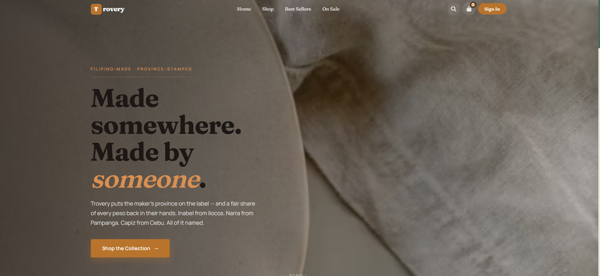
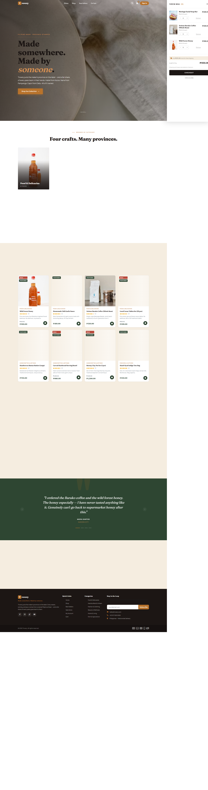
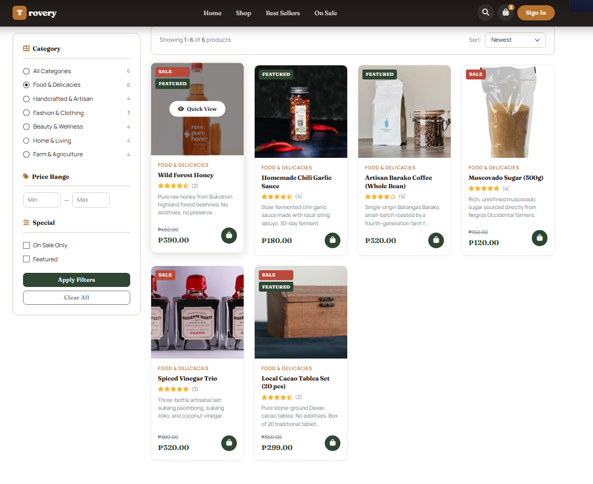
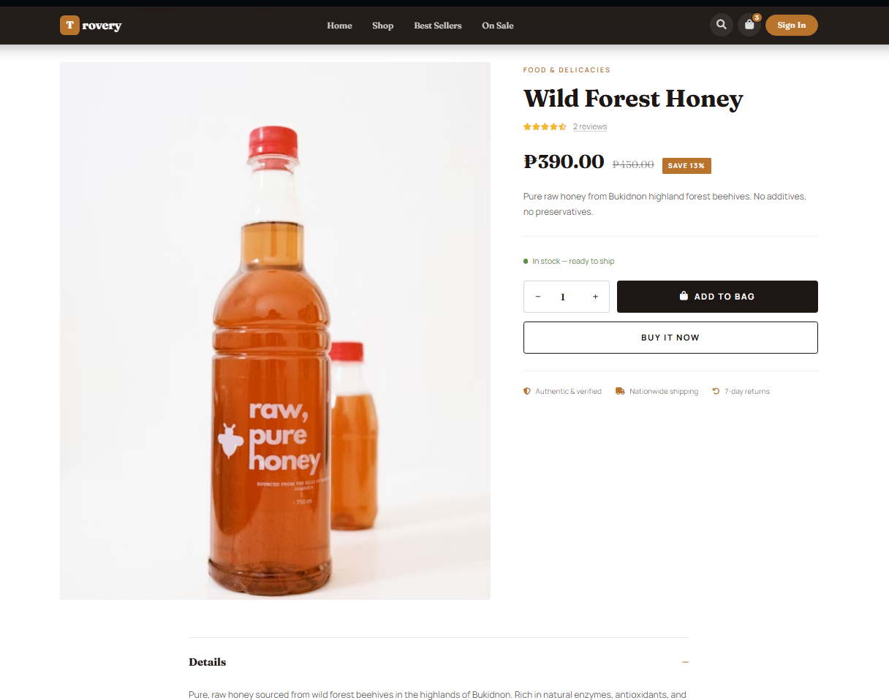
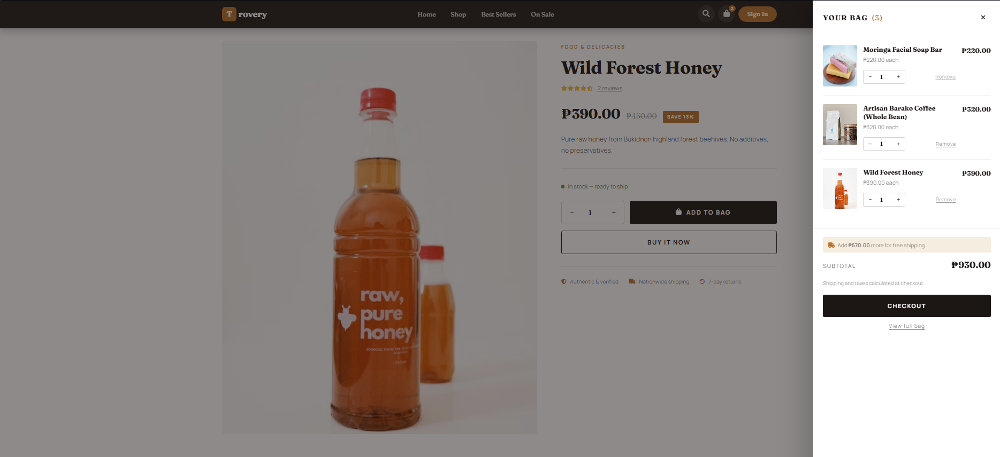
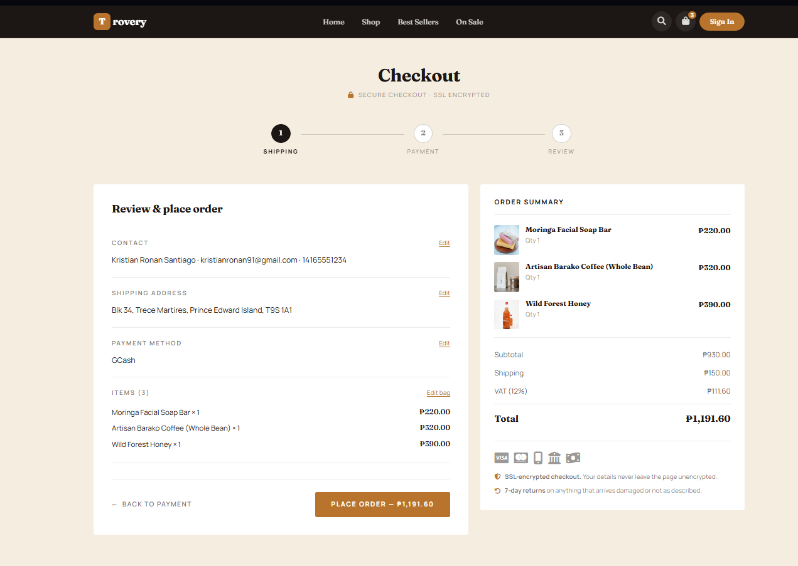
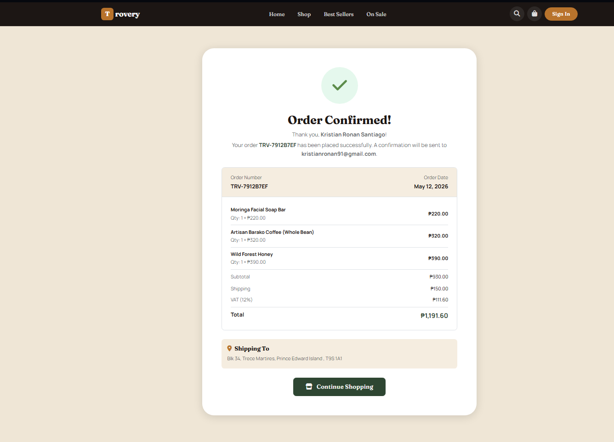
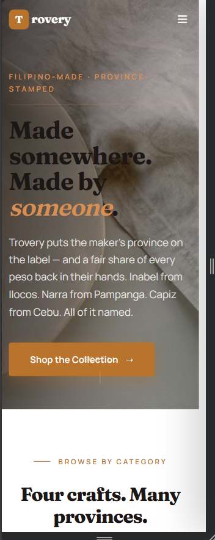
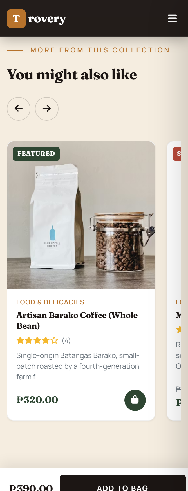

<!-- HERO — drop a wide screenshot of the homepage hero at docs/hero.png -->
<p align="center">
  
</p>

<h1 align="center">Trovery</h1>
<p align="center"><em>Made somewhere. Made by someone.</em></p>

<p align="center">
  <a href="#"></a>
  <a href="#tech-stack"></a>
  <a href="#tech-stack"></a>
  <a href="#tech-stack"></a>
  <a href="#tech-stack"></a>
</p>

---

## Overview

**Trovery** is a full-stack e-commerce store for Filipino-made artisan goods — handwoven textiles from Ilocos, wood-fired pottery from Vigan, single-origin coffee from Batangas, all sold with the maker's province on the label. It's built in PHP and MySQL with a hand-styled Bootstrap front end, and runs locally on XAMPP. I started it as a learning project; it grew into a serious portfolio piece while I figured out how to think about a real database, a real cart, and a real checkout flow.

## The problem

Most Filipino artisan goods reach buyers in two ways: through mass-market platforms that strip out maker attribution, or through Instagram DMs that don't scale. The first reduces a hand-thrown jar to "ceramic decor"; the second makes it impossible to buy more than one thing at a time. Trovery is an attempt at a third option — a real storefront that keeps the maker on the label and the cart on the screen.

## Tech stack

<table>
<tr>
<td><strong>Backend</strong></td>
<td>PHP 8.2 (no framework), MySQL 8, prepared statements via <code>mysqli</code></td>
</tr>
<tr>
<td><strong>Frontend</strong></td>
<td>Bootstrap 5.3, vanilla JavaScript (no build step), Font Awesome 6</td>
</tr>
<tr>
<td><strong>Typography</strong></td>
<td><a href="https://fonts.google.com/specimen/Fraunces">Fraunces</a> (variable serif) + <a href="https://fonts.google.com/specimen/Manrope">Manrope</a> (body sans)</td>
</tr>
<tr>
<td><strong>Local stack</strong></td>
<td>XAMPP (Apache + MySQL) on Windows</td>
</tr>
<tr>
<td><strong>No-build philosophy</strong></td>
<td>Zero npm dependencies. No bundler, no transpiler. View source, hit refresh.</td>
</tr>
</table>

## Key features

- **Editorial homepage** — full-bleed photo hero, image-tile category grid, scroll-snap testimonial carousel, and an "Our Story" section that says who, not what
- **Product detail page** — image gallery with mouse-tracked zoom, optional size/color variant pills, accordion for Details/Shipping/Returns, sticky add-to-cart bar on mobile
- **Slide-in cart drawer** — mini-cart on every page; opens automatically when something is added; ESC and backdrop close
- **3-step single-page checkout** — Shipping → Payment → Review, with a progress indicator and a pinned order summary on desktop
- **Full admin panel** — CRUD for products, categories, orders, users; order status transitions with stock decrement on placement
- **Customer accounts** — registration, login, order history, address pre-fill at checkout
- **Reviews & ratings** — one-review-per-product-per-user enforced by a unique key; auto-recalculates product rating on submit
- **AJAX everywhere it matters** — add to cart, qty updates, drawer refresh, newsletter signup all happen without a page reload; degrades to full-page POST when JavaScript is off

## Screenshots

> Replace these placeholders with real screenshots — save them to `docs/` with the filenames below.

<table>
<tr>
<td align="center"><strong>Homepage</strong><br></td>
<td align="center"><strong>Shop &amp; filters</strong><br></td>
</tr>
<tr>
<td align="center"><strong>Product detail</strong><br></td>
<td align="center"><strong>Cart drawer</strong><br></td>
</tr>
<tr>
<td align="center"><strong>Checkout — review step</strong><br></td>
<td align="center"><strong>Order confirmation</strong><br></td>
</tr>
</table>

<table>
<tr>
<td align="center"><strong>Mobile — Homepage</strong><br></td>
<td align="center"><strong>Mobile — PDP w/ sticky CTA</strong><br></td>
</tr>
</table>

## Design decisions

I want to be specific about three choices, because the obvious alternatives weren't obviously wrong.

### 1. PHP and Bootstrap, not Next.js and Tailwind

A modern stack would have been a more impressive line on a resume. I picked the older one because the project has one developer, no auth provider, no edge functions, no marketing pages outside the store itself — none of the things a JavaScript framework solves. PHP and Bootstrap meant I could focus on the actual hard parts (cart state, checkout flow, admin CRUD) instead of debugging a build pipeline. The whole site has zero npm dependencies and works the second you drop it under `htdocs/`.

### 2. CSS custom properties with semantic aliases for the rebrand

When I rebranded from generic startup colors to a Filipino heritage palette, I didn't search-and-replace every hex code in the codebase. Instead I redefined the brand tokens at the root (`--brand-gold`, `--brand-mangrove`, `--brand-cream`) and aliased the old names to them:

```css
--navy:   var(--brand-mangrove);
--orange: var(--brand-gold);
```

Every existing rule that used `--navy` or `--orange` started rendering the new palette immediately, with no edits. New rules use the brand-prefixed tokens. The aliases are documented as legacy in a code comment so a future cleanup is one grep away.

### 3. Cart drawer renders server-side first, then refreshes via AJAX

The drawer needs to be available on every page (mini-cart UX), and it needs to update without a page reload when items change. The natural temptation was "fetch on open" — leave the drawer empty in HTML and load it the first time someone clicks the cart icon. I went the other way: the drawer body is rendered server-side in `footer.php` on every request, and a small `ajax/cart-drawer.php` partial uses the *same* include to refresh it after AJAX mutations. Tradeoff: every page response is ~2KB larger. Win: the drawer opens instantly, works with JavaScript disabled (it's just a hidden `<aside>`), and there's exactly one source of truth for "what does the cart look like right now" — the same PHP file.

## Performance

_Lighthouse, Mobile profile, localhost run_

| Metric | Score |
|---|---|
| Performance | **85** |
| Accessibility | **86** |
| Best Practices | **100** |
| SEO | **100** |

A few decisions that should help:
- **No build step, no JS framework** — under 30KB of custom JavaScript, no React/Vue bundle to ship
- **CDN-hosted CSS** for Bootstrap and Font Awesome (cached across sites the user has already visited)
- **`loading="lazy"`** on every product card image
- **`preconnect`** to Google Fonts to overlap DNS with the rest of the page

## What I'd build next

In rough priority order:

1. **Payment integration** — wire GCash and PayMongo, replace the cash-on-delivery placeholder
2. **Maker profiles** — each artisan gets a `/makers/<slug>` page; the PDP links to it. This is the whole brand promise made into a feature
3. **Product image multi-upload** — admin uploads a folder, the PDP gallery picks them up automatically (filename convention is already in the front end)
4. **Variants schema** — the PDP renders size/color pills today if the data exists; ship a small migration + admin UI to populate them
5. **Search with filters** — replace the basic `LIKE` query with a proper indexed search (or MeiliSearch) plus category/price/rating facets
6. **Tests** — at minimum, smoke tests for the checkout POST handler. Right now I verify by hand
7. **Real deployment** — currently localhost only. Target: a small VPS with PHP-FPM behind Caddy

## Running it locally

```bash
# 1. Clone into XAMPP's htdocs (or anywhere — see below)
git clone <your-repo-url> trovery

# 2. Import the schema (creates trovery_db)
mysql -u root < trovery/database.sql

# 3. Update credentials if needed
# includes/db.php — defaults to root with no password (XAMPP default)

# 4. Either drop it under XAMPP's htdocs and visit http://localhost/trovery,
#    OR run the built-in PHP server from the project root:
"C:/xampp/php/php.exe" -S localhost:8765
# then open http://localhost:8765
```

## Live demo

> 🚧 **TODO:** Deploy to a VPS or a free PHP host (000webhost, InfinityFree) and replace this line with the URL.

## License

MIT.

---

<p align="center"><sub>Built as a learning project. Filipino artisan goods are real; specific maker names on the demo data are illustrative. Don't ship those to production.</sub></p>
